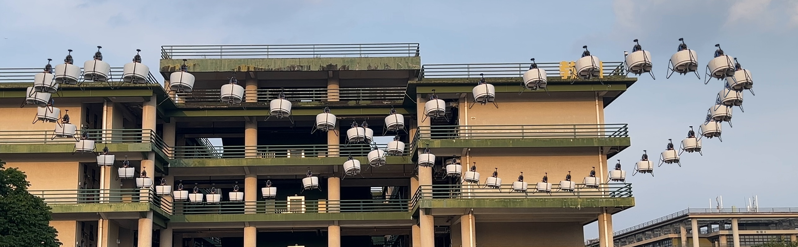

# Object Overlay — SAM 2.1 AI 版

从视频中提取同一目标在不同时刻的位置，并合成为一张叠加图。本仓库用两个长期分支维护两个版本：

| 分支 | 版本 | 目标算法 | Python 依赖 |
| --- | --- | --- | --- |
| `main` | Light 原版 | OpenCV 背景差分 + GrabCut | 轻量，不需要 PyTorch |
| `SAM` | SAM 2.1 AI 版 | SAM 2.1 视频分割与跟踪 | PyTorch CUDA + SAM 2.1 |

`SAM` 分支保留原有的 OpenCV GUI、Mask 编辑器和图像合成模块，但目标 Mask 由 SAM 2.1 生成并通过视频时序传播。两个分支不自动合并；Light 用户继续使用 `main`。

以下命令中的相对路径均以“包含仓库目录的父目录”为起点；如果你的仓库目录名或 worktree 路径不同，替换成自己的路径即可。



## 两个版本

### Light 原版（`main`）

```powershell
cd .\object-overlay   # 进入 Light 工作目录
uv sync
uv run object-overlay "path\to\video.mp4" --select
```

Light 版不安装 PyTorch，也不加载 SAM 2.1；原有背景差分、GrabCut、`overlay` 与 `ghost` 行为保持不变。

### SAM 2.1 AI 版（本分支 `SAM`）

```powershell
cd .\object-overlay-SAM   # 进入 SAM 工作目录
uv sync
uv run object-overlay "path\to\video.mp4" --interval 0.3 --select --mode both
```

SAM 版默认使用 SAM 2.1 Small。首次运行会在背景帧上要求鼠标框选目标，之后由 SAM 2.1 在视频时序中传播同一目标。逐帧复核时按 `M` 修正 Mask，修正会作为新的跟踪条件重新注入 SAM 2.1，并重新计算后续帧。

## Windows 11 原生安装

### 1. 准备环境

- Windows 11 原生环境（不使用 WSL、Ubuntu 或 Docker）。
- NVIDIA 驱动可被 `nvidia-smi` 识别。
- [uv](https://docs.astral.sh/uv/) 已安装。
- Python 3.12（由 uv 按 `.python-version` 管理）。

推荐用 `git worktree` 给两个版本各建一个工作目录，避免共享 `.venv`：

```powershell
cd .\object-overlay
git fetch origin
git worktree add ..\object-overlay-SAM SAM
cd ..\object-overlay-SAM
uv sync
```

如果工作目录已经存在，直接进入该目录执行 `uv sync` 即可。每个 worktree 有独立的 `.venv`、`pyproject.toml` 和 `uv.lock`；模型权重和推理缓存都不提交到 Git。

### 2. PyTorch CUDA

`pyproject.toml` 已把 PyTorch 固定在 CUDA 12.8 构建上：

- `torch==2.11.0`（`cu128`）
- `torchvision==0.26.0`（`cu128`）
- 索引：`https://download.pytorch.org/whl/cu128`

CUDA 12.8 构建包含 RTX 50 系列（Blackwell，`sm_120`）所需的计算能力。安装后先确认不是只“`torch.cuda.is_available()` 为 True”，而是真的能算：

```powershell
uv run python -c "import torch; print(torch.__version__, torch.version.cuda); print(torch.cuda.get_device_name(0)); print(torch.cuda.get_device_capability(0)); x=torch.randn(1024,1024,device='cuda'); y=x@x; torch.cuda.synchronize(); print(float(y.sum()))"
```

最后一行必须输出一个有限数值；如果报 CUDA 错误，按下面的[兼容性问题](#cuda--windows-兼容问题)排查。

### 3. 安装 SAM 2.1

`uv sync` 会安装官方 `facebookresearch/sam2` 代码。Windows 上不需要自定义 CUDA 扩展，建议第一次安装前就设置：

```powershell
$env:SAM2_BUILD_CUDA="0"
uv sync
```

这只跳过 SAM 2 的可选 C++/CUDA 后处理扩展，不影响 PyTorch 的 GPU 推理。本项目不依赖 `decord` 或 WSL；跟踪帧由 FFmpeg 抽成 JPEG 后交给官方 `SAM2VideoPredictor`，FFmpeg 不可用时自动退回 OpenCV 顺序解码。

首次 `uv sync` 需要下载约 2.6GB 的 CUDA PyTorch wheel，并可能在隔离构建环境里额外下载构建期依赖；这是正常的首次安装开销。`uv.lock` 已锁定版本，后续同步会复用缓存。

### 4. 下载 SAM 2.1 Small 权重

权重不提交到仓库，放在 worktree 的 `checkpoints\` 下（已在 `.gitignore` 中忽略）：

```powershell
New-Item -ItemType Directory -Force checkpoints
curl.exe -L -o checkpoints\sam2.1_hiera_small.pt `
  https://dl.fbaipublicfiles.com/segment_anything_2/092824/sam2.1_hiera_small.pt
```

也可以把权重放在任意位置，通过 `--sam2-checkpoint` 或 `SAM2_CHECKPOINT` 环境变量指定。

## 使用

### 基本命令

```powershell
uv run object-overlay ".\examples\drone\input\drone_1.mp4" `
  --interval 0.3 --mode both --select
```

SAM 版默认 `--tracker sam2`。`--tracker motion` 仍保留为后备，但 AI 版通常不需要。

### 交互式菜单

不加 `-y` 时仍会进入原有设置菜单，题目和顺序保持不变；不会新增 SAM 模型、跟踪帧率或权重路径的选择题。最后的“确认开始”清单会多出一段只读的 **SAM 2.1 运行参数**：

```text
  SAM 2.1 运行参数
    模型        sam2.1_hiera_small
    跟踪帧率    15 FPS
    权重路径    <repo-root>\checkpoints\sam2.1_hiera_small.pt
```

这些值直接来自 `RunConfig` 和权重解析函数，不是菜单里另存的常量。默认值由源码中的 `DEFAULT_SAM2_MODEL`、`DEFAULT_SAM2_TRACK_FPS`、`DEFAULT_MODEL` / `resolve_checkpoint()` 决定；开发者要改默认值直接改这些源码即可。已有的 `--sam2-model`、`--sam2-track-fps`、`--sam2-checkpoint` 仍然兼容，并会反映在确认清单里。`--tracker motion` 时不显示这段 SAM 参数。

### 首次指定目标

1. 程序先显示 `--base-frame` 指定的背景帧，例如默认 `frame_0001`。
2. 框选窗口顶部会显示 `Drag a box around the target, then press Enter`；用鼠标框住无人机，按 Enter。
3. SAM 2.1 生成初始 Mask，并显示绿色分割预览。
4. 按 Enter 接受；按 `M` 用现有编辑器修正；按 `R` 重新框选；按 `Q/Esc` 取消。
5. 接受后 SAM 2.1 从该帧向前传播；如果背景帧不是第一帧，也会向视频开头反向传播。

初始化帧和图像合成背景帧在代码中分开管理：初始化帧决定跟踪起点，背景帧只决定 `ghost` 用哪一帧作画布。

### 逐帧复核

背景帧先复核，再进入普通候选帧。两套界面都保留原有习惯：

| 按键 | 功能 |
| --- | --- |
| Enter / Space | 接受当前背景 Mask / 纳入当前候选时刻 |
| `S` | 跳过输出；**不会**从 SAM 2.1 跟踪记忆中删除目标 |
| `M` | 手动框选并修正 Mask，然后注入跟踪器并重传播 |
| `R` | 恢复当前帧的自动预测；人工锚点会从跟踪状态中移除 |
| `B` / Backspace | 回退上一候选；在首个候选帧按 `B` 返回背景帧 |
| `Q` / Esc | 取消本次筛选 |

按 `M` 后先复用现有 OpenCV ROI、GrabCut 和画笔编辑器，得到用户确认的 Mask。该 Mask 会：

1. 写入 `masks_sam2/manual/` 作为人工锚点；
2. 通过官方 `add_new_mask()` 注入 `SAM2VideoPredictor` 的 inference state；
3. 让该帧成为 conditioning frame；
4. 从该帧向后重新调用 `propagate_in_video()`；
5. 如果修正帧早于初始化帧，还会先反向重传播到视频开头。

因此第 16 帧及之后的 Mask 会使用新的跟踪条件，而不是只替换当前帧 PNG。`S` 仅表示“不把该时刻放进最终叠加图”，跟踪状态仍然保留。

### 输出模式

- `overlay`：无损版。背景帧像素不变；候选时刻的 Mask 内直接复制原帧像素。
- `ghost`：残影版。背景帧目标先按用户确认的 Mask 擦除，再作为最早时刻参与渐隐和轨迹线。
- `both`：两种都生成；背景 Mask 只影响 ghost，overlay 背景保持无损。

## 参数

| 参数 | 取值 | 默认 | 说明 |
| --- | --- | --- | --- |
| `video` | 路径 | 必填 | 输入视频 |
| `-y`, `--yes` | 开关 | 关 | 跳过交互式设置菜单 |
| `--mode` | `overlay` `ghost` `both` | `both` | 生成哪种叠加图 |
| `--interval` | 秒 | `0.5` | 输出 Mask 的抽帧间隔 |
| `--base-frame` | 整数 | `1` | 背景帧编号，也是默认的 SAM 2.1 初始化帧 |
| `--output-dir` | 路径 | 见下方 | 结果目录 |
| `--force` | 开关 | 关 | 忽略自动预测缓存并重新传播；人工锚点保留 |
| `--select` | 开关 | 关 | 逐帧复核；SAM 版建议开启 |
| `--tracker` | `sam2` `motion` | `sam2` | `motion` 是保留的轻量后备 |
| `--sam2-model` | `sam2.1_hiera_small` 等 | `sam2.1_hiera_small` | SAM 2.1 模型类型 |
| `--sam2-checkpoint` | 路径 | `checkpoints\<model>.pt` | 权重文件 |
| `--sam2-track-fps` | 浮点 | `15` | 密集跟踪采样目标帧率；输出仍按 `--interval` |
| `--sam2-init-box` | `x,y,w,h` | 无 | 跳过鼠标框选，直接生成初始 Mask；仍会显示预览供确认 |
| `--ghost-min-alpha` | `(0, 1]` | `0.15` | 残影最早时刻不透明度 |
| `--trajectory` / `--no-trajectory` | 开关 | 绘制 | 是否绘制轨迹线 |
| `--trajectory-outline` / `--no-trajectory-outline` | 开关 | 加 | 轨迹线深色描边 |
| `--trajectory-color` | `#RRGGBB` | `#FFA500` | 轨迹线颜色 |

### 跟踪采样与输出采样

`--interval` 是最终候选 Mask 的间隔，不是 SAM 2.1 必须使用的时间间隔。SAM 版会按 `--sam2-track-fps` 抽取更密的跟踪帧，再把输出时刻映射到实际抽帧结果：

```text
原始视频 30 FPS
    ↓  按 --sam2-track-fps（默认 15）密集抽帧
SAM 2.1 时序传播
    ↓  按 --interval 取输出候选
overlay / ghost
```

跟踪帧率会根据输出间隔取整到“每个输出帧恰好对应整数个跟踪帧”的密度，例如 `--interval 0.3`、目标 15 FPS 会使用 16.67 FPS。若视频很长，跟踪帧总数会限制在约 480 帧以控制显存/内存；需要更细的快速目标时可增大 `--sam2-track-fps`，但要同时关注显存。

## 缓存与数据

输出目录中的 SAM 版产物：

```text
frames/                 # 输出抽帧
sam2_frames/            # 密集跟踪 JPEG，可安全删除后重建
masks_sam2/
    auto/               # SAM 2.1 自动传播 Mask
    manual/             # 用户确认的人工锚点
    anchors.json        # 锚点帧号、初始化帧、背景是否人工修正
    manifest.json       # 视频、模型、采样参数、Mask 哈希
masks_corrected/        # 保留的 motion 人工 Mask 目录
overlay.png
overlay_ghost.png
```

- `manifest.json` 会校验视频、抽帧数量/间隔、跟踪采样、模型名、权重路径/大小以及人工锚点哈希。任何一项变化都会让自动预测缓存失效。
- `--force` 会让自动预测缓存失效并重新传播，但**不会删除人工锚点**；人工修正的结果仍然会被复用。
- 人工锚点与自动预测分开存放，不能用空 Mask 推断“用户跳过”；跳过只是本次运行不把该时刻用于合成。
- SAM 版和 motion 版的缓存文件名不同，不会互相覆盖。模型权重、`sam2_frames/`、`masks_sam2/` 不提交到 Git。

## CUDA / Windows 兼容问题

### `torch.cuda.is_available()` 为 False

1. 先运行 `nvidia-smi`，确认驱动正常。
2. 确认安装的是 `torch==2.11.0+cu128`，而不是 PyPI 默认的 CPU 版：
   ```powershell
   uv run python -c "import torch; print(torch.__version__); print(torch.version.cuda)"
   ```
3. RTX 50 系列需要 `sm_120`，CUDA 12.8 或更新的 PyTorch 构建；旧的 cu121/cu124 构建即使能 import torch，也可能在真实算子时报 “no kernel image is available”。
4. 本项目已配置 `pytorch-cu128` 索引；不要在同一个 `.venv` 里先装 CPU torch 再装 CUDA torch。

### 真实 GPU 运算验证

只看到 `is_available()` 不够，必须执行一次矩阵运算：

```powershell
uv run python -c "import torch; x=torch.randn(2048,2048,device='cuda'); y=x@x; torch.cuda.synchronize(); print(torch.cuda.get_device_name(0), float(y.sum()))"
```

### SAM 2 安装时扩展编译失败

```powershell
$env:SAM2_BUILD_CUDA="0"
uv sync
```

本项目使用官方视频预测 API，不依赖自定义 CUDA 后处理扩展；该设置不影响 SAM 2.1 的 GPU 跟踪。不要因此改用 WSL。

### 显存不足（OOM）

- 默认使用 `sam2.1_hiera_small`，不要用 large。
- 降低 `--sam2-track-fps`，例如从 15 降到 8。
- 增大 `--interval` 减少输出帧，但注意跟踪采样仍由 `--sam2-track-fps` 控制。
- 关闭其他占用 GPU 的程序；本项目已把跟踪帧和 inference state 尽量放在 CPU，只在计算时搬到 GPU。
- 如果 8GB 显存仍然不够，优先使用更短的片段或更高 `--interval`，而不是静默改用 motion。

### FFmpeg 与中文路径

程序优先使用系统 FFmpeg；没有时使用 `imageio-ffmpeg` 自带的版本。输出抽帧和 SAM 2.1 跟踪帧都支持 Windows 中文路径。

如果 FFmpeg 报 `Could not open file` 或 `I/O error`，通常是 FFmpeg 进程无法写入输出目录。程序会自动改用 OpenCV 顺序解码重新抽帧；如果 OpenCV 也失败，请把 `--output-dir` 换到当前用户有写权限的目录。

## 测试

```powershell
# 不加载模型的状态管理/缓存/UI 逻辑测试
uv run python -m unittest discover -s tests -v

# 真实 SAM 2.1 GPU 推理、人工修正重传播测试
$env:RUN_SAM2_REAL="1"
uv run python -m unittest tests.test_sam2_real -v
```

真实测试会自动生成一段合成视频并检查：模型加载、Mask 传播、修正锚点进入 conditioning state、后续帧被重新传播。没有 GPU 或权重时会跳过/报出明确原因，不会用 Mock 结果冒充真实推理。

## 已知限制

- SAM 2.1 是通用分割模型，不保证在所有无人机画面中都不漂移；漂移时请在复核界面按 `M` 修正，修正会重传播后续帧。
- 目标短暂离开画面时可能得到空 Mask；不会强行用其他运动物体替代。
- 背景帧只作为 ghost 的擦除对象；overlay 的背景像素始终不修改。
- `--sam2-init-box` 只跳过鼠标框选，初始 Mask 预览仍需要窗口；完全无 GUI 的自动化可调用 `Sam2Tracker` 测试 API（见 `tests/test_sam2_real.py`）。

## 性能与兼容性说明

实际显存占用和跟踪速度取决于 GPU 型号、视频分辨率、目标运动速度和 `--sam2-track-fps`。本项目不承诺特定机型或实时性能；RTX 50 系列需要 CUDA 12.8 或更新的 PyTorch 构建（`sm_120`），详见上文的兼容性章节。

## 项目结构

```text
src/object_overlay/
    cli.py              # 命令行
    masking.py          # 现有 Mask 编辑器、背景帧复核、逐帧筛选
    sam2_tracker.py     # SAM 2.1 跟踪状态、锚点注入、重传播、缓存
    pipeline.py         # 抽帧、跟踪、复核、合成流程
    compose.py          # overlay / ghost 合成
    video.py            # 抽帧和图片读写
tests/                  # 自动化测试
```
